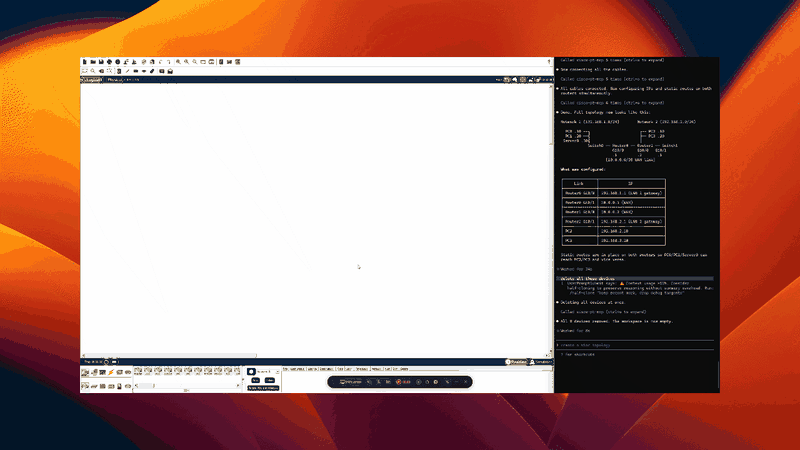

# cisco-pt-mcp

> **Personal fork** of [muhammadbalawal/cisco-pt-mcp](https://github.com/muhammadbalawal/cisco-pt-mcp),
> modified for my own use. Not intended for upstream PRs.
> See [Changes in this fork](#changes-in-this-fork).

Let AI clients control a running Cisco Packet Tracer instance. Open source.



---

## One-prompt install

Paste this into your AI coding assistant (Claude Code, Cursor, Codex, Devin, …):

```text
Install the cisco-pt-mcp MCP server for me — follow the steps in
https://raw.githubusercontent.com/reisen7/cisco-pt-mcp/main/prompt.md
```

Prefer doing it by hand? Keep reading.

---

## Install

Two components. Five minutes.

### 1. MCP Server

[Install uv](https://docs.astral.sh/uv/getting-started/installation/) if you don't have it, then register with your client.
Note: `uvx cisco-pt-mcp` installs the **upstream** PyPI package. To run this
fork's code, install straight from the git repo:

**Claude Code**
```sh
claude mcp add cisco-pt-mcp --scope user -- uvx --from git+https://github.com/reisen7/cisco-pt-mcp cisco-pt-mcp
```

**Cursor** (`~/.cursor/mcp.json` or `.cursor/mcp.json` per project)
```json
{
  "mcpServers": {
    "cisco-pt-mcp": {
      "command": "uvx",
      "args": ["--from", "git+https://github.com/reisen7/cisco-pt-mcp", "cisco-pt-mcp"]
    }
  }
}
```

**VS Code** (`.vscode/mcp.json`)
```json
{
  "servers": {
    "cisco-pt-mcp": {
      "type": "stdio",
      "command": "uvx",
      "args": ["--from", "git+https://github.com/reisen7/cisco-pt-mcp", "cisco-pt-mcp"]
    }
  }
}
```

**Codex CLI** (`~/.codex/config.toml`)
```toml
[mcp_servers.cisco-pt-mcp]
command = "uvx"
args = ["--from", "git+https://github.com/reisen7/cisco-pt-mcp", "cisco-pt-mcp"]
```

### 2. Packet Tracer Extension

1. Open Packet Tracer.
2. Go to **Extensions → Scripting → Configure PT Script Modules…**
3. Click **Add** and select [`cisco-pt-mcp.pts`](extension/cisco-pt-mcp.pts).
4. Restart Packet Tracer.

### 3. Run

Click **Extensions → Packet Tracer MCP** to open the bridge window, then start your MCP client. The status pill flips to `connected` within a second. Start prompting.

---

## Tools

| Tool | Description |
|---|---|
| `addDevice` | Drop a router, switch, or PC onto the canvas |
| `addModule` | Install an interface module into a device slot |
| `addLink` | Connect two devices with a cable |
| `removeDevice` | Delete one or more devices |
| `removeLink` | Delete one or more cables |
| `renameDevice` | Rename an existing device |
| `moveDevice` | Reposition a device on the canvas |
| `setPower` | Power a device on or off |
| `configurePcIp` | Set IP, subnet, gateway, DNS, or enable DHCP on a PC |
| `configureIosDevice` | Run IOS CLI commands on a router or switch |
| `getNetwork` | Snapshot of all devices, interfaces, and cables |
| `getDeviceInfo` | Detailed view of a single device |
| `setSimulationMode` | Switch between simulation and realtime mode |
| `getSimulationStatus` | Query simulation state and frame count |
| `stepSimulation` | Step the simulation forward, backward, or reset |
| `sendPdu` | Add an ICMP ping PDU between two devices |
| `getPduResults` | Read PDU outcomes after stepping the simulation |
| `getCommandLog` | Read the IOS command history logged by Packet Tracer |
| `runPcCommand` | Run a command in a PC's Command Prompt (`ping`, `ipconfig`, …). Needs the updated extension repacked/loaded in PT; PC command-line behavior is not yet verified on live PT |
| `buildTopology` | Add devices, links, and PC IP configs in one call |

---

## Changes in this fork

- **`buildTopology` tool** — devices, cables, and PC IP settings in a single
  round-trip instead of many sequential `addDevice`/`addLink`/`configurePcIp`
  calls. `stopOnError` controls whether a failure aborts the batch.
- **All `addLink` cable types** — every type PT supports is exposed, and
  `auto` actually resolves the cable from the two port types
  (`Port.getType()`), the way PT's own auto-pick works.
- **Console cables work** — ports like `RS 232` and `Console` are never
  listed by `getDeviceInfo`, but `createLink` resolves them by name.
  `addLink` retries these hidden port names automatically, so a console
  cable Just Works (verified live: `PC1:RS 232` ↔ `R1:Console`).
- **Accurate `getNetwork`** — link endpoints are resolved via
  `Port.getOwnerDevice()` (port names repeat across devices), empty
  arrays no longer arrive as `{length: 0}` objects, and hidden ports
  used by a cable are merged into the device's interface list.
- **`addModule` works** — the slot is a *path string*, not an index:
  `"0/0"` installs a WIC-2T on a 2811 (verified live → `Serial0/0/0`,
  `Serial0/0/1`). A bare integer `N` auto-tries `N`, `0/N`, `N/0`.
  Only exotic devices may still need the Physical tab.
- **`runPcCommand` tool** — runs commands in a PC's Command Prompt via a
  start/poll pair (`startPcCommand` + `readPcOutput` in the extension).
  Requires repacking/loading the extension in PT; PC command-line
  behavior is not yet verified on live PT.
- **Startup port-conflict handling** — a stale instance holding
  `127.0.0.1:7531` no longer crashes startup with a raw `OSError 10048`:
  the bridge waits up to `CISCO_PT_MCP_BIND_WAIT` seconds (default 10)
  for it to exit, then fails with a clear message. An opt-in ancestor
  watchdog (`CISCO_PT_MCP_WATCHDOG_INTERVAL=2`; off by default because it
  exited the server spuriously under Devin) can also exit orphaned instances whose `uv` wrapper was killed while the
  stdin pipe stayed open (reproduced live — the orphan held the port
  forever). `CISCO_PT_MCP_PORT` overrides the port for tests.
- **Honest limits** — `serial` links need a WIC-2T/HWIC-2T/NIM-2T module
  (installable via `addModule` with a slot path like `"0/0"`, or by hand);
  `addLink` then finds the `Serial0/x/y` names automatically. Errors say
  when to use the PT GUI.
- **`Hub-PT` model** added to `addDevice`.
- **Wider interface names** — `Console`, `RS232`, `AUX`, `Vlan`, `Port`
  prefixes and an optional space before the port number.
- **PT 8.0 fix** — `runCode` uses `eval` instead of `new Function`, which
  could not see `userfunctions.js` globals inside the Script Module sandbox.

---

## License

MIT
